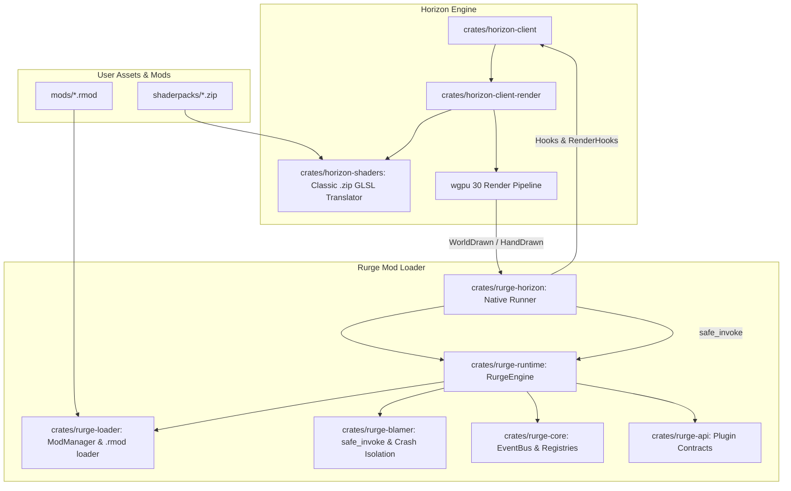

# Design Specification: Rurge Native Client & Shaders Integration

- **Date:** 2026-11-03
- **Topic:** Rurge Client Runtime & Shaders Integration for Minecraft Horizon
- **Status:** Approved (Builder Check Complete)
- **Author:** Game Director & Principal Game Architect (Rurge Team)

---

## 1. Intent and The Why

### Background
Minecraft: Java Edition rewritten in Rust ([Horizon](https://github.com/horizon-rust/horizon)) delivers order-of-magnitude improvements in tick rates, memory consumption, and rendering latency via WebGPU (`wgpu` 30). However, Horizon's built-in mod system relies on a sandboxed Wasmtime Component Model with a 64 MiB RAM ceiling and zero direct GPU/pipeline access. 

**Rurge** was created to be the high-performance native mod loader for Horizon (equivalent to Minecraft Forge / NeoForge, but implemented in 100% native Rust with zero GC allocs and C-ABI stability via `abi_stable`).

### Purpose of This Project
Players and mod authors need:
1. Full support for classic shaderpacks (`.zip` archives with OptiFine/Iris GLSL pipelines: `gbuffers_*`, `shadow`, `deferred*`, `composite*`, `final`).
2. An integrated Rurge Client executable (`rurge-horizon`) that boots Horizon with Rurge's engine active, allowing players to open *Options > Horizon Settings > Shader Packs*, select classic `.zip` packs, tweak shader sliders, and enter singleplayer/LAN worlds.
3. A structured Shader & Rendering API in Rurge so native dynamic `.rmod` mods can react to shaderpack lifecycle events (`ShaderpackLoadedEvent`, `ShaderpackUnloadedEvent`), supply custom uniform buffers, and inject custom WGPU RenderPass stages (`WorldDrawn`, `HandDrawn`, post-processing) without causing graphics device loss or memory leaks.

---

## 2. Goals, Non-Goals, and Anti-Goals

### Goals
- **G1: Native Client Runner (`rurge-horizon`)**: A standalone client binary in the Rurge workspace that links Horizon's client runtime (`horizon_client::entry::main_with`), installs Rurge's native hooks, and launches the game with UI, world generation, and audio intact.
- **G2: Classic `.zip` Shaderpack Support**: Seamless loading and rendering of classic OptiFine/Iris `.zip` shaderpacks via Horizon's `horizon-shaders` Naga translator, selectable directly in the game's shader options UI.
- **G3: Rurge Render & Shaders API (`rurge-api` & `rurge-runtime`)**:
  - Connect Horizon's `RenderHooks` (`world_drawn`, `render_needs`, `hand_drawn`) into Rurge's `RenderPipelineHooks`.
  - Provide safe, prioritized event dispatching for mod-provided post-processing and overlay passes.
  - Expose shaderpack lifecycle events on Rurge's `EventBus`.
- **G4: Fault Tolerance in Render Paths**: Any panic inside an `.rmod` mod's render hook must be trapped by `safe_invoke` and attributed by `rurge-blamer`, ensuring an erroneous mod never crashes the game or invalidates the `wgpu::Device`.
- **G5: End-to-End Playable Test Environment**: Deliver a pre-packaged classic `.zip` shaderpack (`test-classic-shader.zip`) and verify in-game rendering with an active `.rmod` mod.

### Non-Goals
- **NG1: Re-writing GLSL Translators from Scratch**: Horizon already possesses a 30,000-line clean-room GLSL-to-Naga compiler in `crates/horizon-shaders`. Re-implementing a separate GLSL compiler inside Rurge is explicitly out of scope.
- **NG2: Minecraft Java Bytecode Compatibility**: Rurge targets Horizon (Rust edition), not legacy JVM bytecode mods (no Forge `.jar` or Fabric bytecode transformation).

### Anti-Goals (What would make this a failure)
- **AG1: WGPU Device Invalidation**: Submitting invalid command buffers, bad pipeline layouts, or unhandled panics that trigger `wgpu::DeviceLost` or black-screen crashes.
- **AG2: Frame Allocations**: Performing heap allocations (`Vec::new`, `String` formatting, atomic ref-cloning) inside the per-frame render loop.
- **AG3: Sandbox Memory Caps**: Imposing artificial memory limits on native mods (unlike Horizon's 64 MiB Wasm sandbox, Rurge mods have full host memory access).

---

## 3. Constraints

1. **Rust Toolchain**: Rust 1.90+ (matching Horizon client requirements; local environment is rustc 1.96.0, edition 2024).
2. **C-ABI & Memory Safety**: Dynamic libraries across `.rmod` boundaries must satisfy `abi_stable::StableAbi`.
3. **Graphics API**: WebGPU via `wgpu 30` (Vulkan / DirectX 12 / Metal backend).
4. **Operating System**: Windows primary (with cross-platform Linux/macOS compatibility).

---

## 4. Approaches Considered & Selected

### Approach 1 (Selected): Hybrid Engine Orchestrator (`rurge-horizon`)
- **Concept:** Rurge introduces `crates/rurge-horizon`, which implements Horizon's `Hooks` and `RenderHooks` traits. At startup, it discovers `.rmod` packages from `mods/`, initializes `RurgeEngine`, hooks into Horizon's `main_with`, and pipes `WorldDrawn` and `HandDrawn` events to loaded native mods. Classic `.zip` shaderpacks placed in `shaderpacks/` are handled by the game's integrated `horizon-shaders` pipeline.
- **Pros:** Zero redundant GPU allocations; full compatibility with existing `.zip` shaderpacks; complete panic isolation on mod hooks; direct integration with Horizon's settings menus and world generation.
- **Cons:** Requires coordinating with Horizon's mod trait signatures.

### Approach 2 (Rejected): Autonomous `.rmod` Shader Engine (Iris Clone)
- **Concept:** Write a standalone `.rmod` dynamic library that attempts to intercept raw swapchain textures and implement an independent GLSL compiler and deferred G-buffer renderer.
- **Why Rejected:** Severe architectural duplication (re-implementing 30K+ lines of GLSL/Naga AST code already present in Horizon), risk of swapchain lock contention, and high probability of `DeviceLost` errors.

### Approach 3 (Rejected): Binary DLL Injection / Detours
- **Concept:** Compile Rurge as a standalone DLL and inject it into a pre-compiled Horizon binary at startup.
- **Why Rejected:** Fragile, platform-dependent on Windows, breaks address space layout randomization (ASLR), and unnecessary given Horizon's open modular codebase.

---

## 5. Architectural Specification & Subsystem Details

### 5.1 System Architecture Diagram

### 5.2 Builder Check & Architecture Resolutions (Calls Made)

Following the Builder Review, five critical architectural questions were settled:

#### 1. Workspace Topology & Dependency Resolution (Builder Call)
- `crates/rurge-horizon` links to `horizon-client` via path dependency `path = "../horizon/crates/horizon-client"`.
- Rurge workspace `Cargo.toml` sets `rust-version = "1.90"` to align with Horizon's requirements.
- Any root-level `[patch.crates-io]` required by Horizon's `wgpu-hal` and `naga` versions are mirrored in Rurge's root `Cargo.toml`.

#### 2. Upstream Modification vs. Black-Box Hooking (Builder Call)
- Upstream Horizon remains an **unmodified black-box** dependency.
- Shaderpack lifecycle changes are detected cleanly without touching Horizon's hook generators: `rurge-horizon` monitors the active shader state during `render_needs` and `shader_params` callbacks, dispatching `ShaderpackLoadedEvent` / `ShaderpackUnloadedEvent` through Rurge's `EventBus` whenever the active pack name changes.

#### 3. FFI / C-ABI Boundary Contract for GPU Resources (Builder Call)
- Native `.rmod` plugins do **not** receive raw non-FFI WGPU device pointers.
- Instead, `rurge-api` defines an ABI-stable `RenderPassContext`:
  - Viewport dimensions (`[u32; 2]`).
  - Partial tick (`f32`).
  - Camera position (`[f64; 3]`) and view/projection matrices (`[f32; 16]`).
- Overlay rendering by mods is provided through structured vertex/mesh submissions (or registered host-side pipeline passes), maintaining strict `abi_stable::StableAbi` compliance.

#### 4. GPU Command Buffer Panic Isolation (Builder Call)
- To prevent a mod panic from corrupting Horizon's primary `CommandEncoder` and causing `wgpu::DeviceLost` (Anti-Goal AG1), `rurge-horizon` creates an **isolated secondary command encoder** for mod render passes.
- The mod callback runs inside `safe_invoke`.
- If the mod executes cleanly: the secondary encoder is finished and submitted to `wgpu::Queue`.
- If the mod panics: the secondary encoder is dropped, Horizon's main encoder remains completely untouched, and the game continues rendering without graphic device interruption.

#### 5. Scope of Custom Uniform Injection (Builder Call)
- Rurge maps mod-provided uniform data into Horizon's built-in `mods[0..7]: array<vec4<f32>, 8>` shader parameter block via `Hooks::shader_params`.
- This provides zero-overhead GPU data transfer directly into classic and WGSL shaders without modifying Horizon's Naga translator.

---

## 6. What's Left to the Builder

- Internal implementation details of `crates/rurge-horizon/src/main.rs` and `hooks.rs`.
- Aesthetic shader parameters for `test-classic-shader.zip` (lighting curve, color warmth, vignette strength).
- Developer CLI aliases (`cargo rurge run`).

---

## 7. Verification & Acceptance Criteria

1. **Compilation:** `cargo check --workspace` and `cargo test --workspace` pass with 0 errors and 0 clippy warnings.
2. **Client Startup:** Running `cargo run -p rurge-horizon` boots the Horizon client window.
3. **Mod Discovery:** Rurge logs show discovered `.rmod` mods loaded into `RurgeEngine`.
4. **Shaderpack Verification:** Navigating to *Options > Horizon Settings > Shader Packs* displays the test classic `.zip` shaderpack. Enabling it applies the shader pipeline without WGPU errors.
5. **Gameplay Entry:** Creating or joining a singleplayer world successfully renders terrain under the active shader.
