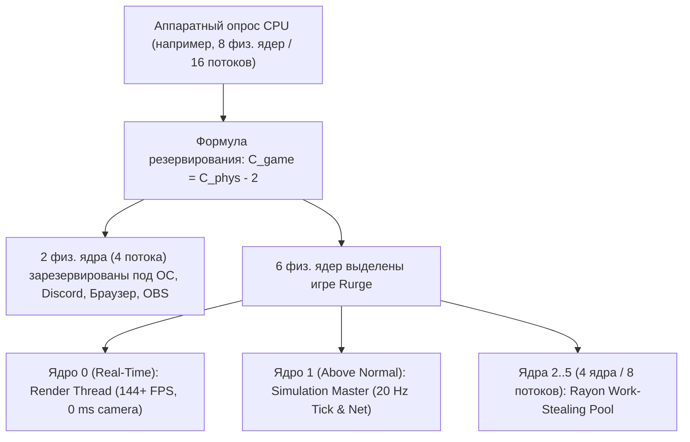
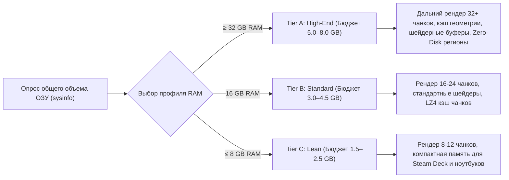
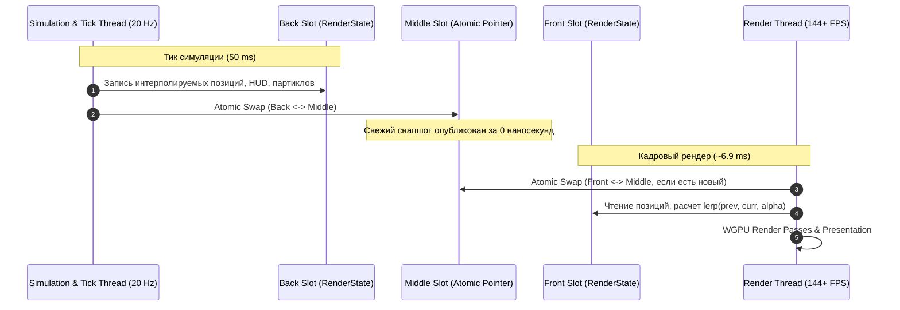
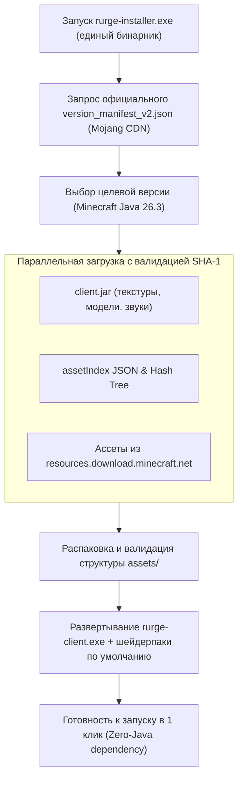

# 🚀 Global Architectural Blueprint & Master Plan: Multi-Core `rurge-client` & Standalone Installer

## 1. Фундаментальный вызов: почему наивный многопоток убивает воксельные игры

В классическом Minecraft (Java Edition) и текущем Horizon симуляция мира исторически заперта в **один поток**. Попытки сообщества сделать наивный многопоток (навесить `Mutex`/`RwLock` на чанки и сущности) приводили к катастрофе:
1. **Lock Contention и Deadlock Hell**: в воксельном мире всё взаимодействует со всем (хопперы передают вещи через границы чанков, редстоун обновляет соседей, мобы сталкиваются и пересекают границы). Если 16 ядер процессора будут блокировать друг друга мьютексами, 80% времени CPU тратится на ожидание замков, и производительность падает **ниже однопотока**.
2. **Cache Bouncing (разорение кэша L1/L2/L3)**: когда несколько ядер одновременно модифицируют соседние структуры памяти в одной кэш-линии (64 байта), процессор тратит сотни тактов на инвалидацию шины (false sharing).
3. **Аллокаторный затор (Heap Fragmentation)**: создание временных объектов (векторы лучей, списки сущностей, пакеты) из 16 потоков перегружает стандартный системный аллокатор.

### Наш инженерный ответ в `rurge-client`
Мы строим архитектуру на **6 фундаментальных столпах**:
1. **Адаптивный регулятор железа и резервирование ядер под ОС** (гарантия отсутствия лагов в Windows/Discord).
2. **Многоуровневая система использования ОЗУ (Smart RAM Scaling)** (максимальный FPS при больших объемах памяти).
3. **Энергосберегающий диспетчер фокуса (Focus & Minimize Governor)** (сброс нагрузки GPU/CPU при Alt-Tab).
4. **Пространственная декомпозиция и Deferred Command Buffers** (параллельный тик без взаимных блокировок).
5. **Физическая изоляция рендера** (Lock-Free Triple Buffering, 144+ FPS с 0 ms camera latency).
6. **Автономный установщик и прямой загрузчик ассетов** (One-Click Installer с CDN Mojang).

---

## 2. Столп I: Адаптивный регулятор ядер CPU и резервирование под ОС

При запуске клиент через модуль `rurge_client::hardware` сканирует топологию процессора:
- Физические ядра ($C_{\text{phys}}$) и логические потоки ($C_{\text{log}}$) через `num_cpus` и `std::thread::available_parallelism()`.



### Формула умного распределения ядер CPU ($C_{\text{phys}}$):
| Физические ядра CPU | Выделено игре ($C_{\text{game}}$) | Зарезервировано под ОС ($C_{\text{os}}$) | Потоки воркеров Rayon | Назначение |
| :--- | :--- | :--- | :--- | :--- |
| **4 ядра** (бюджетные ПК) | **3 ядра** | **1 ядро** | 2 воркера | Система не задыхается |
| **6 ядер** (мейнстрим) | **4 ядра** | **2 ядра** | 4 воркера | Свободный Discord/браузер |
| **8 ядер / 16 потоков** | **6 ядер** | **2 ядра (4 потока)** | **6–8 воркеров** | Идеальный баланс без лагов |
| **12–16+ ядер** (High-End) | **$C_{\text{phys}} - 3..4$** | **3–4 ядра** | **14–24 воркеров** | Максимальная параллелизация |

### Правила распределения приоритетов:
1. **Render Thread**: привязка к первому P-ядру, приоритет `THREAD_PRIORITY_HIGHEST` / QoS User Interactive.
2. **Simulation Master**: второе P-ядро, приоритет `THREAD_PRIORITY_ABOVE_NORMAL`.
3. **Rayon Pool**: фоновые рабочие ядра без жесткой привязки (affinity), что позволяет планировщику Windows 11 свободно распределять фоновые задачи между P и E ядрами.

---

## 3. Столп II: Умное масштабирование памяти (Smart RAM Scaling в Rust)

Справедливое замечание: 24 ГБ — это привычка из мира Java-модов, где JVM тратит 60% памяти на оверхед заголовков объектов (boxing, pointer overhead) и паузы сборщика мусора (GC).

В **Rust** структуры данных упакованы без оверхеда (`#[repr(C)]`, flat arrays), а объекты не оборачиваются в ссылочные заголовки. По реальным замерам в `docs/server-levels.md`, Horizon при активном Оверворлде и Незере потребляет всего **~1.2 ГБ RSS**!

Поэтому аппетиты Rurge должны быть реалистичными и бережными к системе:



### Реалистичные лимиты памяти в Rust:

#### 1. Профиль High-End (≥ 32 ГБ ОЗУ на ПК) — потолок 5.0–8.0 ГБ:
- Запас для экстремальной дистанции прорисовки (32–48 чанков), тяжелых шейдерпаков (Complementary с объемным светом) и сотен нативных `.rmod` модов.
- Хранение всех активных файлов `.mca` в ОЗУ для мгновенной подгрузки без дисковых микрофризов.
- Даже при самом жестком сценарии игра **никогда не займет более 8 ГБ**, оставляя 24+ ГБ под любые другие задачи пользователя.

#### 2. Профиль Standard (16 ГБ ОЗУ на ПК) — бюджет 3.0–4.5 ГБ:
- Оптимальный режим для комфортной игры на 16–24 чанках с шейдерами.
- Система и фоновые приложения (браузер с 30 вкладками, Discord, Spotify) имеют в запасе стабильные 11–13 ГБ.

#### 3. Профиль Lean (≤ 8 ГБ ОЗУ / Steam Deck / ультрабуки) — бюджет 1.5–2.5 ГБ:
- Предельно сжатые структуры, стриминг текстур и чанков по требованию.
- Игра работает плавно даже на портативных устройствах с ограниченной распаянной памятью.

---

## 4. Столп III: Диспетчер фокуса и сворачивания (Power & Minimize Governor)

Для исключения бесполезного нагрева видеокарты и шума кулеров при переключении в браузер или сворачивании игры:

```mermaid
stateDiagram-v2
    [*] --> ActiveFocused: Запуск игры
    ActiveFocused --> Unfocused: Клик в другое окно (Alt+Tab)
    Unfocused --> ActiveFocused: Возврат фокуса
    Unfocused --> Minimized: Сворачивание в панель задач
    Minimized --> ActiveFocused: Развертывание окна

    state ActiveFocused {
        note "Target FPS: 144/240+ (Hz монитора)\nGPU: 100% штатная отрисовка\nRayon Pool: Полная мощность" as N1
    }

    state Unfocused {
        note "Target FPS: 30 FPS\nGPU: Ограничение кадровой частоты\nRayon Pool: Пониженный приоритет" as N2
    }

    state Minimized {
        note "Target FPS: 5–10 FPS (thread sleep)\nGPU: 0% (полный пропуск swapchain present)\nSimulation Master: Строго 20 Hz (без дисконнектов)" as N3
    }
```

### Поведение при состояниях окна:
1. **Окно активно (Active & Focused)**:
   - Максимальный FPS (частота обновления монитора 144, 240, 360 Гц или разблокирован).
   - Все потоки работают на максимальной производительности.
2. **Окно не в фокусе (Unfocused / фоновый браузер)**:
   - Кадровая частота принудительно ограничивается до **30 FPS**.
   - Нагрузка на GPU падает на 70–80%.
3. **Окно свернуто (Minimized / Iconified)**:
   - Кадровая частота падает до **5–10 FPS** через `thread::sleep` / `ControlFlow::WaitUntil`.
   - **Отрисовка GPU полностью отключается**: вызовы `wgpu::Queue::submit` и `surface.present()` пропускаются, видеокарта сбрасывает частоты до базовых (0% нагрузки, холодные вентиляторы).
   - **Симуляция тика (Simulation Master) продолжает работать строго на 20 Гц**: игрок не вылетает с сервера по таймауту, печи продолжают плавить, фермы работают.

---

## 5. Столп IV: Пространственная декомпозиция (Spatial Domains & Command Buffers)

Как запускать симуляцию мобов и блоков параллельно на выделенных ядрах **без единого мьютекса**?

### 1. Шахматная сетка (Checkerboard 4-Color Grid)
Чанки делятся на пространственные домены так, чтобы чанки одного цвета никогда не граничили друг с другом:
$$C(x, z) = (|x| \bmod 2) + 2 \cdot (|z| \bmod 2) \in \{0, 1, 2, 3\}$$

```text
[0] [1] [0] [1] [0] [1]
[2] [3] [2] [3] [2] [3]
[0] [1] [0] [1] [0] [1]
[2] [3] [2] [3] [2] [3]
```

- **Фаза симуляции цвета 0**: все воркеры параллельно обрабатывают только чанки цвета 0. Никакой моб или блок физически не может достать до другого активного чанка.
- Затем последовательно фазы 1, 2, 3.

### 2. Deferred Mutation Buffers (Командные буферы изменений)
Для операций, пересекающих границы или меняющих глобальное состояние (нанесение урона, спавн предметов, взрывы, редстоун-сигналы через границу):
- Потоки симуляции работают в режиме **Read-Only** к текущему состоянию мира.
- Любое изменение записывается в локальный `ThreadLocal<CommandBuffer>`:
  ```rust
  pub enum WorldMutation {
      SetBlock { pos: [i32; 3], state: BlockState },
      DamageEntity { target: EntityId, amount: f32, source: DamageSource },
      SpawnEntity { entity: Box<EntityData> },
      DespawnEntity { id: EntityId },
      TransferItem { from: [i32; 3], to: [i32; 3], slot: u8 },
  }
  ```
- **Синхронизационный барьер тика**: в конце фазы тика Simulation Master детерминированно объединяет буферы мутаций и применяет их к миру в строгом порядке, исключая гонки данных и рассинхроны.

---

## 6. Столп V: Разделение Render/Tick и Lock-Free Triple Buffer



- **0 мс блокировок**: Render Thread никогда не ждет завершения тика; Simulation Thread никогда не ждет отрисовки GPU.
- **Интерполяция $\alpha$**: движение мобов, покачивание рук и частицы всегда плавные на любой частоте развертки (60, 144, 240, 360 Гц).

---

## 7. Столп VI: Автономный установщик и прямой загрузчик ассетов (`rurge-installer`)

Пользователю больше не нужно вручную искать и копировать файлы Minecraft или устанавливать сторонние лаунчеры:



### Возможности `rurge-installer`:
1. **Прямое скачивание с официальных серверов Mojang**:
   - `https://piston-meta.mojang.com/mc/game/version_manifest_v2.json`
   - `https://resources.download.minecraft.net/<hash[0..2]>/<hash>`
2. **Многопоточный параллельный даунлоадер**:
   - Параллельные HTTP-соединения на пуле потоков Rayon с верификацией контрольных сумм SHA-1.
3. **Автоматическая подготовка окружения**:
   - Извлечение текстур, моделей, blockstates и языковых файлов непосредственно в каталог `assets/`.
   - Установка бинарника `rurge-client.exe`, шейдеров (`Complementary Reimagined` / `test-classic-shader`) и пресетов настроек графики (Auto/Vulkan).
4. **Zero Java Dependency**: игра работает целиком нативно на Rust/WGPU без необходимости наличия JVM на компьютере игрока.

---

## 8. Структура крейтов в репозитории Rurge

```text
rurge/
├── Cargo.toml                  # Включает crates/rurge-client и crates/rurge-installer
├── crates/
│   ├── rurge-api/              # C-ABI стабильные интерфейсы и события плагинов
│   ├── rurge-core/             # EventBus, реестры, SemVer DAG резолвер
│   ├── rurge-runtime/          # Ядро исполнения модов, ContentSchemaExecutor
│   ├── rurge-installer/        # 📦 АВТОНОМНЫЙ УСТАНОВЩИК И ЗАГРУЗЧИК АССЕТОВ
│   │   ├── src/
│   │   │   ├── main.rs         # CLI/GUI установщика
│   │   │   ├── mojang_cdn.rs   # Запрос манифеста и хэш-дерева ассетов
│   │   │   ├── parallel_dl.rs  # Многопоточный HTTP загрузчик с проверкой SHA-1
│   │   │   └── unpacker.rs     # Извлечение client.jar в assets/
│   │   └── Cargo.toml
│   ├── rurge-client/           # 🌟 АВТОНОМНЫЙ МНОГОПОТОЧНЫЙ КЛИЕНТ (16+ ядер)
│   │   ├── src/
│   │   │   ├── main.rs         # Точка входа, инициализация потоков и пулов
│   │   │   ├── hardware.rs     # Аппаратный профилировщик CPU/RAM и резерв для ОС
│   │   │   ├── governor.rs     # Регулятор FPS при сворачивании и потере фокуса
│   │   │   ├── sync/           # Lock-Free TripleBuffer, InputRingBuffer
│   │   │   ├── memory/         # Thread-Local Bump Arenas, Object Pools, Tiers
│   │   │   ├── simulation/     # Checkerboard Grid, Deferred Command Buffers
│   │   │   ├── thread_render.rs# Выделенный поток Winit/WGPU (144+ FPS, 0 ms camera)
│   │   │   ├── thread_tick.rs  # Выделенный поток тика (20 Hz, Net, Physics)
│   │   │   └── mesh_pipeline.rs# Неблокирующий прием мешей от Rayon воркеров
│   │   └── Cargo.toml
│   └── cargo-rurge/            # CLI для сборки и упаковки модов и клиента
```

---

## 9. Глобальный генеральный план реализации


- **Этап 0: Каркас крейтов `crates/rurge-client` и базовые примитивы памяти/потоков**
  - Создание `crates/rurge-client` и линковка к `horizon-world`, `horizon-client-render`, `horizon-protocol`, `rayon`.
  - Модуль `hardware.rs` (Опрос CPU/RAM, формула выделения ядер $C_{\text{phys}} - 2$ и профили памяти).
  - Модуль `sync::triple_buffer` (Lock-Free тройной буфер с нулевыми аллокациями).
  - Модуль `memory::arena` (Thread-Local Bump Arenas для тиков и кадров).
  - Модуль `sync::input_queue` (Lock-Free атомарная очередь ввода).
- **Этап 1: Физическое разделение Render Thread, Tick Thread и Governor**
  - Выделенный поток симуляции `rurge-tick` (20 Гц).
  - Модуль `governor.rs`: обработка `Focused(false)` (30 FPS) и `Minimized` (5–10 FPS со сном и отключением GPU present).
  - Модификация главного цикла Winit: вынос сетевого парсинга и `tick_remote()` из `RedrawRequested`.
  - Мгновенная камера (0 ms latency) и субтиковая интерполяция $\alpha$.
- **Этап 2: Параллельный неблокирующий мешинг чанков на рабочих ядрах**
  - Устранение `recv_timeout` из рендер-пути (`streaming.rs`).
  - Очередь мешей через `try_recv()` с бюджетом загрузки в GPU (≤2.0 мс на кадр).
- **Этап 3: Многоядерная симуляция (Spatial Domains & Rayon Simulation)**
  - Внедрение шахматного разбиения чанков (Checkerboard Grid) для параллельного тика мобов и тайлов.
  - Внедрение `ThreadLocal<CommandBuffer>` для отложенного применения мутаций мира без гонок данных.
  - Параллелизация тиков сущностей через Rayon `par_iter_mut`.
- **Этап 4: Интеграция `RurgeEngine` и потокобезопасной системы модов**
  - Монтирование плагинов `.rmod` с разделением диспетчеризации хуков по потокам.
- **Этап 5: Автономный установщик `crates/rurge-installer`**
  - Клиент Mojang CDN манифестов и хэш-дерева ассетов.
  - Многопоточный параллельный загрузчик ассетов с верификацией SHA-1.
  - Распаковщик `client.jar` в `assets/` и One-Click деплой клиента.
- **Этап 6: Профилирование, стресс-тесты и бенчмаркинг**
  - Тестирование 144+ FPS при 1 000 сущностей и генерации чанков на скорости полета.
  - Замер 1% и 0.1% lows, Flamegraph-профилирование отсутствия аллокаций в горячих циклах.
